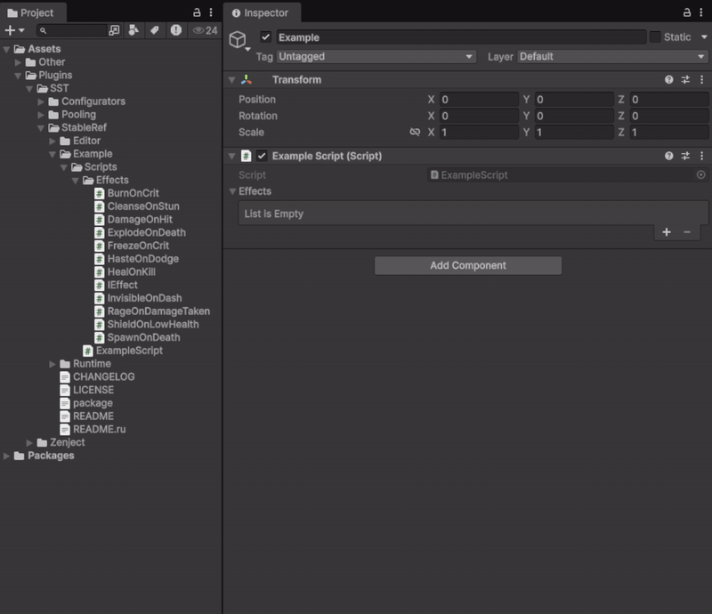
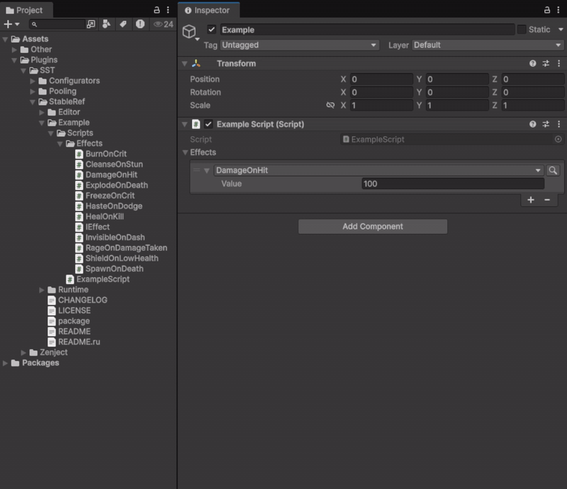
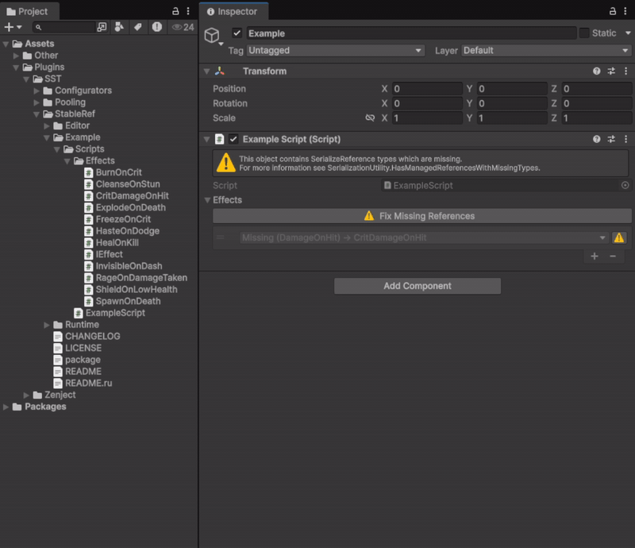

[](../../releases)
[](../../releases)
[](../../commits)
[](LICENSE.md)

**English** | [Русский](README.ru.md)

---

A convenient, reliable wrapper over Unity's `[SerializeReference]`.

StableRef makes working with polymorphic serialized references stable and comfortable: a searchable typed inspector selector, safe copy/paste, and editor tooling to find and fix references. On top of that, references survive class renames — a stable string type ID is stored alongside the object, so renaming or moving a class does not break existing serialized data.

## Table Of Contents

<details>
<summary>Details</summary>

- [Installation](#installation)
- [The problem it solves](#the-problem-it-solves)
- [Classes and attributes](#classes-and-attributes)
- [Usage](#usage)
  - [Declaring a stable type](#declaring-a-stable-type)
  - [Using StableRef\<T\> in a field](#using-stablereft-in-a-field)
  - [Using StableRefList\<T\>](#using-stablereflistt)
  - [Copying owners: MemberwiseClone](#copying-owners-memberwiseclone)
  - [Reflection and serializers](#reflection-and-serializers)
  - [Generic value types](#generic-value-types)
  - [Selector without a wrapper: \[RefSelector\]](#selector-without-a-wrapper-refselector)
- [Auto-generated ID](#auto-generated-id)
  - [Types you can't edit: RefTypeIdFor](#types-you-cant-edit-reftypeidfor)
- [Samples](#samples)
- [Editor tools](#editor-tools)
- [Inspector integration](#inspector-integration)
- [Copying and pasting](#copying-and-pasting)
- [License](#license)

</details>

---

## Installation

1. **.unitypackage** — [Releases](../../releases)
2. **UPM** — `Window → Package Manager` → `+` → `Add package from git URL`:
   `https://github.com/SST-Systems/StableRef.git`
   Append `#tag` to pin a version.
3. **Manual** — clone or download, copy to `Assets/`.

Unity 2021.3+

---

## The problem it solves

Unity's built-in `[SerializeReference]` stores the full type name. If you rename or move a class, Unity loses the reference and the field becomes `null`. `StableRef` stores a permanent type ID instead, so the class can be renamed freely.

---

## Classes and attributes

| Type | Purpose |
|---|---|
| `StableRef<T>` | Serializable wrapper holding a single polymorphic reference of type `T`. |
| `StableRefList<T>` | Serializable list of rename-safe values, usable as an `IList<T>`. |
| `[RefTypeId("id")]` | Assigns a permanent ID to a class. Rename the class freely — Unity will still find it. |
| `[assembly: RefTypeIdFor(typeof(T), "id")]` | The same for a type you can't edit — another package, a DLL, generated code. |
| `[RefCategory("Path")]` | Groups the type under a submenu in the inspector selector. |
| `[RefSelector]` | The same selector on a plain `[SerializeReference]` field, with no wrapper and no rename protection. |

---

## Usage

### Declaring a stable type

```csharp
[Serializable]
[RefTypeId("my-package.damage-on-hit")]
[RefCategory("Combat")]
public class DamageOnHit : IEffect
{
    public int Amount;
}
```

The `[RefTypeId]` value must be unique across the project — use a namespaced string. The attribute is **not inherited**: a derived class needs its own `[RefTypeId]` (or its own script file, see [Auto-generated ID](#auto-generated-id)).

### Using StableRef\<T\> in a field

```csharp
public class ItemConfig : ScriptableObject
{
    public StableRef<IEffect> OnPickup;
}

if (config.OnPickup.HasValue)
    config.OnPickup.Reference.Apply();

config.OnPickup.Set(new DamageOnHit { Amount = 5 });
config.OnPickup = new StableRef<IEffect>(new DamageOnHit { Amount = 5 });
```

Prefer `Set` over writing `.Reference` directly: it keeps the stored ID up to date when the value's type changes. There are no implicit conversions between `StableRef<T>` and `T` — use `.Reference` and the constructor.

### Using StableRefList\<T\>

```csharp
public class AbilityConfig : ScriptableObject
{
    public StableRefList<IEffect> Effects;
}

foreach (var effect in config.Effects)   // values, no allocation
    effect?.Apply();

config.Effects.Add(new DamageOnHit { Amount = 5 });
config.Effects.RemoveAll(e => e is DamageOnHit);
var damage = config.Effects.OfType<DamageOnHit>().Sum(d => d.Amount);
config.Effects[0] = new Heal();
```

`StableRefList<T>` is an `IList<T>` / `IReadOnlyList<T>` of the values: indexer, `foreach`, LINQ and the familiar `List<T>` methods work with `T`. The underlying entries are available through `Items`.

When you fill a list from an **editor script**, call `StableRefResync.ResyncObject(asset)` before saving (see [Reflection and serializers](#reflection-and-serializers)).

<p align="center">
  
</p>

### Copying owners: MemberwiseClone

The wrappers are classes, so an owner cloned with `MemberwiseClone` shares them with the original — changing the clone's value changes the original too. Give the clone its own wrappers:

```csharp
public Effect ShallowClone()
{
    var clone = (Effect)MemberwiseClone();
    clone.Modifier = Modifier.ShallowCopy();   // new wrapper, same value instance
    clone.Children = Children.ShallowCopy();   // new list, same value instances
    return clone;
}
```

### Reflection and serializers

Code that knows a field's type only at run time (config loaders, custom serializers) can use the non-generic API:

```csharp
if (StableRefReflection.IsStableRef(field.FieldType, out var valueType))
{
    var entry = (StableRefBase)(field.GetValue(owner) ?? Activator.CreateInstance(field.FieldType));
    entry.BoxedValue = Convert(cell, valueType);
    field.SetValue(owner, entry);
}
else if (StableRefReflection.IsStableRefList(field.FieldType, out var elementType))
{
    var list = (StableRefListBase)(field.GetValue(owner) ?? Activator.CreateInstance(field.FieldType));
    list.SetBoxedValues(ConvertArray(cell, elementType));
    field.SetValue(owner, list);
}
```

`StableRefBase` has `BoxedValue`, `ValueBaseType`, `HasValue`; `StableRefListBase` has `ElementType`, `Count`, `GetBoxed`, `SetBoxed`, `AddBoxed`, `SetBoxedValues`, `Clear`. Setters check the type and throw `ArgumentException` on a mismatch.

**Writing into assets in the editor.** Only the inspector can record a value's recovery data. A tool that writes values into assets (an importer, a generator) should call `StableRefResync.ResyncObject(asset)` before saving, or run **Tools → StableRef → Resync All** afterwards — otherwise a later class rename can't be recovered correctly.

**Newtonsoft.Json:** a ready converter ships as a sample — [Newtonsoft.Json Converter](Samples~/NewtonsoftJson/README.md).

### Generic value types

For a field like `StableRefList<ICondition<Unit>>` the selector offers matching generic types closed with the field's argument (`All<Unit>`, `Any<Unit>`). Each type used as a generic argument needs its own stable ID, like any other StableRef type.

The selector's gear button holds its settings: size, *Category in Label*, *Namespace Categories* and *Deep Search*. Namespace Categories (on by default) lists a type without `[RefCategory]` under its namespace (`Game.Effects` → *Game/Effects*); `[RefCategory]` always takes precedence. With Deep Search on, the search also matches the script file name, so `Conditions` finds every class declared in `Conditions.cs`.

### Selector without a wrapper: [RefSelector]

When you want only the inspector selector — no wrapper, no stored ID, nothing extra in the data — mark a plain `[SerializeReference]` field with `[RefSelector]`:

```csharp
public class EffectAuthoring : MonoBehaviour
{
    [SerializeReference, RefSelector] private IEffect _onPickup;
    [SerializeReference, RefSelector] private List<IEffect> _effects;
}
```

The field stays an ordinary `[SerializeReference]` (no `.Reference`), and the attribute doesn't reach player builds. Useful for ECS authoring, for existing fields you don't want to migrate, and for large lists where per-entry metadata isn't worth it. To migrate existing fields with their data, see the [SerializeReference Migration](Samples~/SerializeReferenceMigration/README.md) sample.

> **Use at your own risk.** `[RefSelector]` fields have **no rename protection** and are not covered by **Find Usages** or **Fix Missing Types**. To rename such a class safely, add Unity's `[MovedFrom]` to it.

---

## Auto-generated ID

`[RefTypeId]` is optional. Without it, StableRef uses the script file's GUID (from its `.meta`) as the ID:

- **Class rename** — safe.
- **Script file rename or move** — safe, the GUID doesn't change.
- **Deleting and recreating the file** — the reference is lost; the entry shows up in Fix Missing Types.

For types you plan to refactor heavily, an explicit `[RefTypeId]` is more reliable. Switching an existing type to `[RefTypeId]` is safe: old data keeps resolving and is updated to the new ID when drawn in the inspector or by **Tools → StableRef → Resync All**.

> **Important:** keep one class per script file — the GUID belongs to the file, not to the class.

### Types you can't edit: RefTypeIdFor

A type from another package, a DLL or a source generator can't take `[RefTypeId]`. Give it an ID at assembly level, in any assembly of your project:

```csharp
[assembly: RefTypeIdFor(typeof(ThirdParty.Effects.Burn), "my-game.third-party.burn")]
[assembly: RefTypeIdFor(typeof(ThirdParty.Conditions.All<>), "my-game.third-party.all")]
```

- **Priority:** `[RefTypeId]` on the type → `RefTypeIdFor` → script GUID.
- **Generics:** map the open definition (`All<>`).
- **Uniqueness:** the same rules as for `[RefTypeId]`; duplicates are logged as errors.

---

## Samples

Import via **Window → Package Manager → StableRef → Samples**.

| Sample | What it shows |
|---|---|
| [Newtonsoft.Json Converter](Samples~/NewtonsoftJson/README.md) | StableRef fields read and write the same JSON as bare `T` / `List<T>` fields — for remote configs, saves and server payloads. Requires Newtonsoft.Json. |
| [SerializeReference Migration](Samples~/SerializeReferenceMigration/README.md) | Switching a project from `[SerializeReference]` fields to StableRef with one button — both the code and the saved data. |

---

## Editor tools

All tools are available under **Tools → StableRef**. They scan prefabs and ScriptableObjects under `Assets/` (including sub-assets) and the scenes that are currently open.

Find Usages and Fix Missing Types show results in a tree with search: click a row to ping its object, double-click or use the arrow keys to expand, `Alt`+click to expand everything under a row.

**Find Usages** — every place a selected type is used. Also available from a script's context menu: `Assets/Find StableRef Usages`.

<p align="center">
  
</p>

**Fix Missing Types** — finds StableRef fields whose type no longer exists, so you can fix broken references after a refactor before they turn into data loss.

<p align="center">
  
</p>

**Resync All** — updates the stored ID and recovery data of every entry to match its current value. The inspector does this while you edit; run Resync All after values were written by code. Values themselves are never changed. From code: `StableRefResync.ResyncObject(target)` or `StableRefResync.ResyncAssets(paths)`.

**Metadata Size Report** — estimates how much space the StableRef metadata takes, in builds and in assets.

**Metadata in builds.** Only the type ID and the value go into player builds. The display name and the recovery snapshot are editor-only and cost nothing in builds.

**What recovery restores.** Each entry keeps a snapshot of its value. After a class rename, recovery restores its fields, nested objects, lists and `UnityEngine.Object` references. `AnimationCurve` and `Gradient` are not captured.

Entries that can't be resolved are **skipped and kept** — restore the type and run the fix again. To discard one, pick None in its selector or use **Set to None** from its context menu; replacing a missing entry always asks for confirmation.

**When Unity loses references the file still holds**, the fix gets them back from the file instead of recreating them:

- **A file Unity can't read.** When a class without serialized fields goes missing, Unity saves its reference in a form it can't load back, and the object loses *all* its references on every load. The fix removes that one reference from the file (the field becomes None; an entry with an ID is then recreated from its snapshot) and logs what was removed. Text-serialized files only. If the class was renamed, add `[MovedFrom]` to it before fixing. Before it happens, the scan and the inspector show such a field as *Broken*, and Fix All (or the field's warning button) sets it to None so the save is safe — the entry keeps its ID and is recreated once the class is back.
- **References lost after a domain reload.** An object that holds a missing type can lose all its references in memory on the next domain reload, while its file is intact. Assets are read from disk again during the scan; open scenes are reloaded after you confirm — don't save such a scene before that.

---

## Inspector integration

For projects with their own IMGUI inspector framework:

- **`IStableRefChildrenDrawer`** — assign to `StableRefDrawing.ChildrenDrawer` to draw the fields inside StableRef values through your framework.
- **`IRefTypeMetadataProvider`** — names, categories, tooltips and order of types in the selector from your own attributes.
- **`StableRefEditorUtility.GetValueProperty(property)`** — the managed reference of both a `StableRef<T>` and a plain `[SerializeReference]` field.

Details are in the XML docs of these types.

---

## Copying and pasting

Unity's **Copy Component** / **Paste Component Values** can corrupt `[SerializeReference]` data when copying between a scene and a prefab. Use the right-click menu instead:

- **A field** — `StableRef/Copy`, `StableRef/Paste`.
- **A list element** — `Paste as New Element`, `Duplicate Array Element` (a deep copy), `Delete Array Element`.
- **A list header** — `StableRef/Copy` for all entries, `StableRef/Paste/Replace` or `StableRef/Paste/Append`.

> **Warning:** `[SerializeReference]` fields (StableRef included) don't always survive built-in Unity operations — Duplicate, drag & drop, prefab apply/revert, merges. Commit before bulk changes.

---

## License

Distributed under the [MIT License](LICENSE.md). Free for personal and commercial use.

Author — **Egor Shesterikov**.
